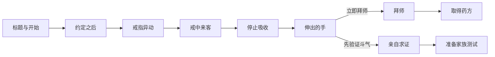

# 斗破苍穹互动剧情与视频制作清单

《戒中人》以退婚后的萧炎为玩家视角。三年之约已经立下，他还需要找到重新修炼的办法。开场到选择点发生在萧家后山，药老现身后，玩家决定立即拜师，或者先亲自验证斗气能否留在体内。

退婚、三年之约和药老相助的背景依据[《缘起》官方介绍](https://wetv.vip/zh-cn/play/inzslk0p79msbg3-%E6%96%97%E7%A0%B4%E8%8B%8D%E7%A9%B9%E7%BC%98%E8%B5%B7)。[第一季官方介绍](https://wetv.vip/zh-cn/play/7tvogbkk02zrjtf/m003116e7s6)说明戒中幽魂及魔兽山脉历练。[药老官方资讯](https://www.taptap.cn/moment/677481258070050803)说明斗气被吸收的原因，[中国作家网的图书介绍](https://www.chinawriter.com.cn/n1/2016/0704/c404025-28522871.html)明确恢复修炼的前提为药老停止吸收。夜晚、对白和全部分支为本项目创作。

本次交付范围为第一章的一段完整可玩内容。九个剧情片段各八秒，每个片段按动作和对白拆成独立生成的子镜头；每次游玩经过其中七个剧情片段，视频合计五十六秒，选择等待时间另计。分支两侧各有十六秒独立剧情，分别结束在取得修炼药方、准备验证天赋的状态。

## 整体剧情

主线沿乌坦城、魔兽山脉、塔戈尔沙漠和云岚宗发展，地点与修炼目标依据[《三年之约》官方介绍](https://wetv.vip/zh-cn/play/zvq11aob914jkag-%E6%96%97%E7%A0%B4%E8%8B%8D%E7%A9%B9%E4%B8%89%E5%B9%B4%E4%B9%8B%E7%BA%A6)。下表中的选择及后果属于互动改编。

| 篇章 | 眼前目标与阻碍 | 玩家选择造成的剧情变化 |
| --- | --- | --- |
| 戒中人 | 萧炎需要恢复修炼，药老承认曾借走他的斗气 | 拜师路线取得药方，进入采药修炼；求证路线保留戒指，先去验证天赋 |
| 乌坦城重修 | 药材需要花钱，家族仍以过去的成绩看待萧炎 | 准备药材进入炼药练习；参加家族测试进入公开检验，两条路线分别呈现准备与后果 |
| 魔兽山脉 | 离开家族庇护，历练中遇到受困者与追踪者 | 帮助受困者进入合作脱险；追踪线索进入独自探路，人物位置与遭遇分别保存 |
| 沙漠异火 | 找到提升实力的机会，同时承担危险 | 继续深入进入异火试炼；先带同伴撤离进入救援与重整，两条后续由各自已发生的事情继续 |
| 云岚宗赴约 | 三年期限已到，需要完成与纳兰嫣然的约定 | 选择持续周旋或冒险出招，分别进入耐力交锋和受伤反击的镜头；胜负及离场结果由对应线路明确展示 |

## 第一章的场景与对白

片头由标题和开始按钮进入C01。标题为“斗破苍穹·戒中人”，背景字卡为“退婚当夜，萧家后山”。标题、字幕和按钮由后期排版呈现。

| 视频 | 时间 | 可见动作 | 原创对白或字幕 | 下一步 |
| --- | --- | --- | --- | --- |
| C01 约定之后 | 0至8秒 | 萧炎站在山路边，望向山下灯火，慢慢低头看自己的手 | 萧炎：“三年。可我连今天的斗气都留不住。” | C02 |
| C02 戒指异动 | 8至16秒 | 他重新运气，一缕微弱气息流向古戒；指尖发冷，他立刻收手 | 萧炎：“又消失了？” | C03 |
| C03 戒中来客 | 16至24秒 | 古戒浮出一团淡烟，药老在他面前现身；萧炎退开半步 | 药老：“这些年，是我借了你的斗气。” | C04 |
| C04 停止吸收 | 24至32秒 | 萧炎攥紧拳头；药老主动停止吸收，古戒的微光熄灭 | 萧炎：“你先停下！”药老：“已经停了。你的天赋还在。” | C05 |
| C05 伸出的手 | 32至40秒 | 药老伸出手，萧炎看向他的手，又看向古戒；两人保持距离 | 药老：“我能教你重新修炼。你愿意学吗？” | 等待玩家选择 |
| A01 拜师 | 0至8秒 | 萧炎单膝跪下，抬头看药老；药老收起笑意，点头 | 萧炎：“教我。我想亲自走上云岚宗。” | A02 |
| A02 第一个任务 | 8至16秒 | 药老口述备药事项，萧炎在掌心依次点过四下，点头后起身转向下山路 | 药老：“天亮去备药。少一样，重新找。” | 路线A结尾，进入采药修炼的后续 |
| B01 亲自求证 | 0至8秒 | 萧炎仍戴着戒指，盘坐后再次运气；呼吸逐渐平稳，他睁眼看向药老 | 萧炎：“先让我试一次。” | B02 |
| B02 留下证据 | 8至16秒 | 他收拢手掌，起身望向山下；药老在旁等他决定 | 萧炎：“明天去试炼场。结果出来，我再拜师。” | 路线B结尾，进入家族测试的后续 |

A路线最后显示“已记下修炼药方”。B路线最后显示“斗气不再流失，明日继续求证”，本场修为保持原来的水平。两个结尾都保留“返回选择”和“重新开始”，玩家能够查看另一条线路。

A02的备药清单采用本人确认的紫叶兰草、三叶青芝、木灵藤、凝魂花。该清单属于本项目互动改编的内容，具体字幕与八秒内的动作节奏在A02单段制作时核对。

## 连续图片与视频

剧情片段之间共有十张独立边界帧。公共部分使用F00至F05，两条线路都从同一张F05开始；路线A新增FA01、FA02，路线B新增FB01、FB02。各片段内部还需增加子镜头的共享边界帧，每条连续路径均满足实际子镜头数量n与边界图片数量n+1的关系。

| 图片 | 画面需要保存的状态 |
| --- | --- |
| F00 | 后山全景，萧炎面向山下灯火，衣服与戒指清晰可辨 |
| F01 | 萧炎已经低头，戴戒指的手处于近景，为重新运气的下一段保留姿态 |
| F02 | 戒指微亮，萧炎收手，烟雾刚出现 |
| F03 | 药老已经现身，萧炎退后，两人位置确定 |
| F04 | 萧炎握拳，古戒微光已经熄灭，二人距离保持 |
| F05 | 药老伸手，萧炎尚未回应，画面下部留出选项区域 |
| FA01 | 萧炎完成拜师动作，药老点头 |
| FA02 | 萧炎合拢手掌，转向下山路，药老在身侧 |
| FB01 | 萧炎戴着戒指盘坐，呼吸平稳，睁眼看向药老 |
| FB02 | 萧炎起身望向山下，古戒继续戴在原处 |

| 剧情片段 | 片段首帧 | 片段尾帧 | 总时长 |
| --- | --- | --- | --- |
| C01 | F00 | F01 | 8秒 |
| C02 | F01 | F02 | 8秒 |
| C03 | F02 | F03 | 8秒 |
| C04 | F03 | F04 | 8秒 |
| C05 | F04 | F05 | 8秒 |
| A01 | F05 | FA01 | 8秒 |
| A02 | FA01 | FA02 | 8秒 |
| B01 | F05 | FB01 | 8秒 |
| B02 | FB01 | FB02 | 8秒 |

相邻视频引用同一张实际图片的素材标识与SHA-256。F05只生成和采用一份，分支入口复用该文件。镜头移动、人物位置和光线从上一段尾帧继续，公共部分及两条线路的首尾图片分别核验。

## C01的子镜头

| 子镜头 | 时长 | 画面与动作 | 首帧 | 尾帧 |
| --- | --- | --- | --- | --- |
| C01-1 | 3秒 | 后山远景，萧炎望向山下灯火，镜头缓慢靠近人物 | F00 | C01-K1 |
| C01-2 | 3秒 | 推进至人物中景，萧炎低头，神情失落，戴戒指的手逐渐进入关注位置 | C01-K1 | C01-K2 |
| C01-3 | 2秒 | 手与古戒特写，保持当前姿态，为C02衔接 | C01-K2 | F01 |

C01共三段独立视频和四张独立边界图片。本人已确认3秒、3秒、2秒的镜头节奏：“三年。”在开头低声说出，后半句从约1.9秒跨第一、第二镜头连续说到约5.4秒；最后两秒保留风声、呼吸和手指轻微收拢，古戒仅呈现金属反光。画面中的人物、服装、古戒、光线及动作保持一致。每个子镜头均单独核对真实成果；其余剧情片段依据具体动作和对白确定子镜头数量、时长及画面，制作前逐段确认。

本人确认山下灯火呈现为远处暖黄小光点，带轻微薄雾；声音由夜风、极轻虫鸣和萧炎呼吸构成，无配乐。

## 制作与确认

按C01、C02、C03、C04、C05、A01、A02、B01、B02的顺序逐段制作，每段使用独立素材对话。总监每次只安排当前八秒剧情片段的子镜头脚本、角色、场景、边界图片与短视频。代理自主核对、生成并修正文字和图片，视频生成前把实际首尾帧、镜头内容和参数交本人确认；各子镜头完成后在平台编排成当前八秒片段，再继续下一段。角色和场景采用已确认版本，后续片段只补充实际需要的变化。

C01制作F00、C01-K1、C01-K2与F01。后续片段复用已经采用的实际首帧，并为内部子镜头新增所需边界图片。A01与B01均复用同一份F05。新图片由代理通过平台生成和检查，每段固定首尾帧短视频提交前等待本人确认。

人物采用《斗破苍穹》动画式正常身材比例，保留萧炎和药老的形象特征，角色、分镜与视频排除Q版、幼化和夸张头身比例。通过页面明确选择本段参考图片，普通素材库中的图片只有实际绑定本轮引用后才能用于生成。

所有脚本与剧情排布由本人Codex处理；素材制作沿用DeepSeek Flash、商汤和北京Wan的既定配置。岗位依据、生图提示词和工具明细保留开发记录。素材展示区呈现本轮剧本正文、实际图片和实际视频。原始引用图保留来源与版本。

每段视频完成后核对首尾图片、实际视频时长、人物一致性及字幕，再在对应剧情场景采用。普通选择需要等待用户操作；两条路线各自拥有实际成片和结尾。验收分别操作两条路线，检查返回选择、重新开始及网页刷新后的项目数据。
