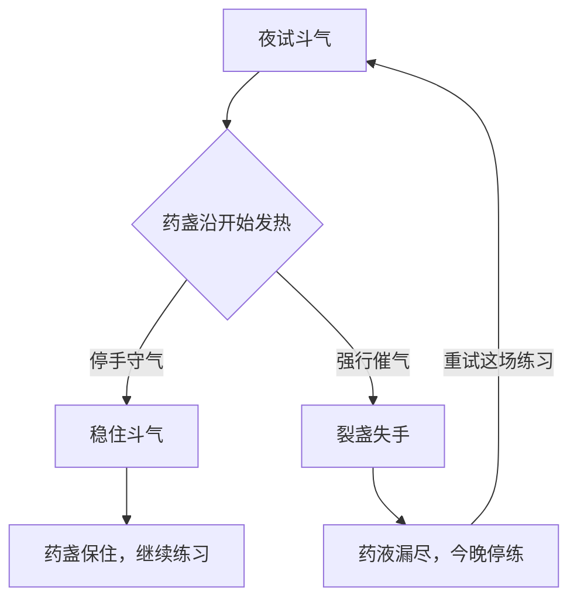

# 斗破苍穹·裂盏

练功房里，药尘让萧炎把斗气维持在药盏上方。照规矩，盏沿一热就该停。萧炎察觉盏底的旧釉纹动了一下，门外巡夜的灯影也快掠过门缝。药尘看着盏沿说「盏沿一热，就停。」画面停在萧炎悬着的右手。玩家决定他收手还是再催一成。

## 三场戏

| 场景 | 0–4 秒 | 4–8 秒 | 画面停留 |
| --- | --- | --- | --- |
| 夜试斗气 | 门缝月光照过石案。萧炎举起右掌，斗气把药液压出一圈细颤。 | 药尘抬起宽袖，手悬在盏沿侧面。他说「盏沿一热，就停。」巡夜灯影移近门缝。 | 萧炎指间的古戒、悬在盏上方的右手和盏底的旧釉纹同框。播放器叠加两个选择。 |
| 稳住斗气 | 接同一画面。萧炎将右掌缓缓抬离药盏，在手发抖时稳住呼吸。 | 灯影掠过门缝。药液最后一圈波纹消失，药尘收袖说「保持住。」 | 药盏完整，萧炎喘匀了气，可以接着练习。 |
| 裂盏失手 | 接同一画面。萧炎再压一成，右手发抖，旧釉纹扩成一条细裂。药尘移袖出声制止。 | 细裂贯到盏沿，碎片打在石案上。萧炎握紧古戒，再伸手拢住裂盏，药液从指缝漏掉。药尘说「今晚到这儿。」 | 停在裂盏与打湿的手。训练中止，次日要去药房补药。播放器提供重试。 |

三场共六段视频，每段四秒。两条分支的开场均使用「夜试斗气」八秒处的同一张图片。每场两段视频在四秒处也共用一张图。全篇需要七张独立边界图。人物对白和巡夜脚步用作声音线索，画面内只呈现故事发生的事物。

| 边界图 | 画面 |
| --- | --- |
| 开场 0 秒 | 从门内拍石案和木门的一角。萧炎在画面右侧，药尘立于案左，药盏居中。右手垂在案外，药液平稳。 |
| 开场 4 秒 | 同侧中景。萧炎右掌抬至盏口上方，药液开始细颤，掌下出现薄薄一层白金光。药尘侧目看向盏沿，暖灯留在画面远处。 |
| 开场 8 秒，两条分支共用 | 石案略低机位。右手、无名指上的一枚古戒和完整药盏在同一焦平面内，旧釉纹刚可辨认。药尘的白袖停在盏侧后方，门缝的巡夜灯影进入画面边缘。 |
| 稳住 4 秒 | 机位不动。萧炎抬掌离开盏口，五指由绷紧转为松开。药液波纹缩小，门缝暖影正移过。 |
| 稳住 8 秒 | 拉至萧炎胸口以上和石案同框。萧炎吐出一口气，盏内药液平静，药尘正在收回手。门缝重新露出冷光。 |
| 失手 4 秒 | 药盏和手的近景。萧炎的右掌压得更低，掌下微光变薄，旧釉纹已延伸成细裂，盏中药液尚在。 |
| 失手 8 秒 | 延续失手近景。药液渗到石案上，盏侧缺了一片粗陶。一小片碎陶落在案面，萧炎双手拢盏，右手无名指保留同一枚古戒。斗气微光熄灭。 |

## 画面基准

- **萧炎**　参考《缘起》少年时期。肩颈清瘦，头身比例正常。窄长少年脸，下颌线清楚，眼睛大小自然。黑发中间露额，两侧发束垂下，后发束起。深红立领、黑色叠层武服及暗色护腕贯穿三场。古戒固定在右手，冷光擦过时看得见旧金属划痕。
- **药尘**　采用同期年轻无须的脸和中分直长银白发。银白冷蓝刺绣宽袖、深青腰饰，灵体边缘带淡冷光。他用眼神、短促对白和悬停的手势制止萧炎，留出萧炎承担选择后果的空间。
- **练功房与药盏**　萧家后院的小间。冷色月光斜穿木门缝，弱暖灯落在冰凉的石案边缘。青灰粗陶盏有一条能在同一角度反复辨认的旧釉纹。低阶斗气只在掌下和盏边留少量白金光。用材质、布料褶皱和反光表现正片的三维动画质感。
- **人物和道具连续性**　边界图逐张核对脸型、发型、服装、手指、戒指、盏形、釉纹位置和光线方向。剪切通过人物和物件的动作完成，临近共用帧时维持人物朝向、手的位置及同一盏的破损程度。

早期剧情和同期画面采用《缘起》的官方版本。萧炎与药尘的脸、发型和衣服同时以阅文公开的角色建模为观察依据。练功、选项和两条结果为本项目创作的情节。[WeTV《缘起》第 2 集](https://wetv.vip/zh-cn/play/inzslk0p79msbg3/w00455g4d3c-EP02%3A_Battle_Through_the_Heavens_Special_4%3A_Origin) · [阅文官方角色建模展示](https://www.bilibili.com/video/BV1wt4y1a7rp/)
