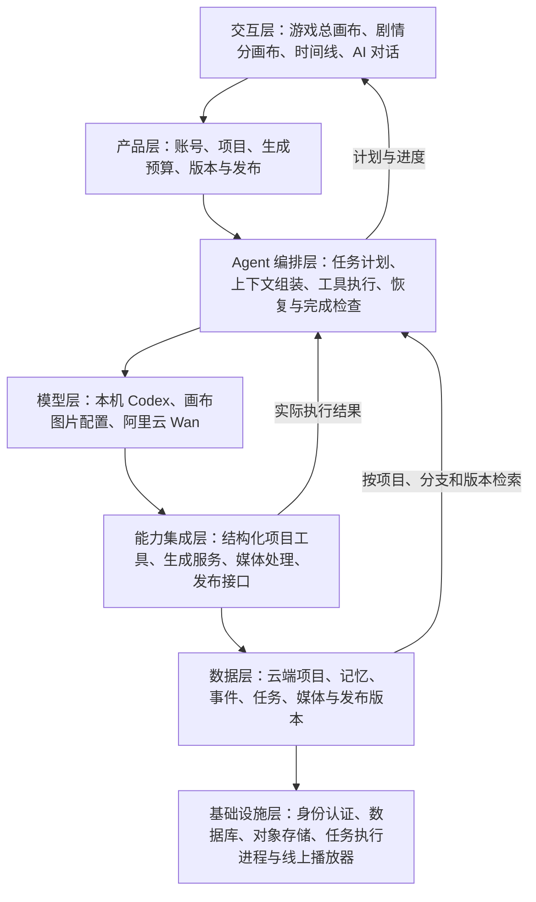

# SceneTurn 创作代理架构

日期：2026-11-12。依据：已验收的个人在线制作MVP需求、用户阶段0回答与工坊提供的代码事实。完整保留注册和登录，按本人在线制作验收；媒体任务串行执行，创作数据全量保存，支付保留扩展接口。

## 1. 现有操作能力

- 在本阶段需求确认时，桌面端 Codex 对话按只读权限运行。项目写入由后续的 SceneTurn 项目工具提供，并受服务端鉴权和任务授权约束。
- 无限画布 `frontend/src/lib/canvas/canvas-agent-ops.ts` 已定义添加、更新、删除节点、建立和删除连线、选择节点以及 `run_generation` 等操作。
- `frontend/src/pages/canvas/hooks/use-agent-bridge.ts` 将画布快照与操作入口交给 Agent store，并把生成操作转交生成回调。这是可复用的结构化操作边界；后端 Agent 连接及跨应用操作尚待运行验证。
- 两侧尚需统一项目权限、版本检查、云端保存与任务状态，才能将这些操作用于持续的创作任务。

## 2. Harness 五要素

| 要素 | 设计 |
|---|---|
| 工具 | 读取项目、检索记忆、写入脚本、修改画布、提交与查询生成任务、采用素材、编辑场景、验证与发布 |
| 知识 | 项目设定、人物关系、分支事件、分镜规范、模型能力、时间线规则及素材来源 |
| 观察 | 最新项目版本、用户修改、工具执行结果、生成进度、可解码媒体、场景验证结果及发布状态 |
| 行动 | Agent 提交带类型的工具调用，由业务服务校验并执行；手动界面调用相同业务操作 |
| 权限 | 用户与项目访问范围、任务授权阶段、生成预算和发布授权；每次读写在服务端检查 |

## 3. 七层结构

数据流：用户提出场景目标，产品服务取得当前项目版本；Agent 检索相关历史并制定计划，经授权检查调用生成与编辑工具；工具把结果写入云端任务和项目，Agent 读取实际结果继续执行，最终验证互动场景并按授权发布固定版本。

## 4. 组件采用依据

| 工作区组件 | 本项目中的用途 |
|---|---|
| s01 Agent Loop | 根据目标、历史和工具结果决定下一步；素材阶段开放执行，覆盖全流程的工具权限可分别控制 |
| s02 工具系统 | 通过明确输入输出操作画布、素材与场景 |
| s03 权限系统 | 检查项目访问、授权阶段、生成预算及发布权限 |
| s04 钩子系统 | 工具调用前检查版本与授权，调用后记录执行结果和关联事件 |
| s05 任务规划 | 展示脚本、分镜、生成、场景验证与发布任务及其依赖 |
| s08 上下文压缩 | 为单次调用整理摘要并保留原始来源，控制上下文容量 |
| s09 记忆系统 | 共享角色、剧情、素材、用户决定和历史事件 |
| s10 任务系统 | 持久保存目标、执行进度、远端任务标识和中断位置 |
| s11 后台任务 | 视频生成、上传、媒体处理与发布期间保持编辑可用 |
| s15 集成 Harness | 统一模型适配、工具、记忆、授权和任务生命周期 |
| s16 工作流运行时 | 持久执行提交、查询、下载、校验、采用和发布等确定步骤 |
| s17 目标闭环 | 根据实际媒体、场景和线上验证结果判断完成；内容评价与确定性检查分别记录 |

这些是依据明确需求作出的设计选型，后续实现必须逐项证明能力。脚本 Agent 的共享记忆通过同一项目服务实现，Agent 实例数量由实际任务需要决定。

## 5. 共享记忆与上下文组装

云端保留三类相互关联的数据：当前有效项目状态、可追溯的创作事件、模型检索使用的摘要与索引。每项记录携带 `projectId`、对象标识、来源版本、事件时间、剧情时间、适用分支和有效状态。

故事事件记录剧情内发生了什么；创作事件记录用户采用、拒绝、修改或生成了什么。候选脚本和未采用视频保留候选状态。生成失败记录为操作事件，不能成为剧情事实。

每次写分镜依次取得：用户当前指令、有效项目设定、当前场景及其分支祖先的事件、相关已采用素材、相关历史决定、未解决矛盾。多分支合流时检查条件，无法确定的历史保留条件描述。

总画布节点持有稳定的 `sceneId`，剧情分画布持有所属 `projectId` 和 `sceneId`；生成任务再绑定 `shotId` 或 `clipId`。制作顺序从总画布进入分画布，游戏分支继续由总画布连接表达。用户在不同分画布间切换时，根据同一云端记忆服务提取目标场景上下文。

脚本、对话、工具结果、记忆、任务、素材候选、原始媒体及发布版本全量保存，保留原文与来源，自动清理关闭。对话用于所属账号的历史与项目记忆；产品改进和训练的独立授权保持关闭。公开作品不开放创作对话，其他账号和项目的检索无法访问这些记录。

模型输入只携带本次需要的原文片段、摘要和媒体引用。完整历史持续保存；摘要关联来源，用户修改来源后使相关摘要和依赖产物失效。较新的用户决定优先，已生成内容保留其实际版本。

## 6. 工具契约

所有工具都携带用户身份和 `projectId`。写入工具同时携带 `expectedRevision` 与唯一操作标识；服务端检查权限和版本，重复操作返回已有结果。

| 工具 | 输入 | 输出 | 副作用与授权 |
|---|---|---|---|
| read_project | 项目标识、需要的对象 | 当前对象与版本 | 按项目权限读取 |
| retrieve_context | 场景、分支、目标、容量限制 | 带来源与版本的上下文 | 按权限读取记忆 |
| write_script | 脚本或分镜变更、目标版本 | 新版本与变更记录 | 写入授权范围内的脚本 |
| apply_canvas_ops | 类型化操作列表、目标版本 | 实际应用结果与新版本 | 修改节点与引用关系 |
| submit_generation | 模型、参数、输入素材、唯一操作标识、确认记录 | 项目任务及远端任务标识 | 文本按任务自动执行；图片和视频须有与本次输入匹配的用户确认 |
| inspect_generation | 任务标识 | 远端状态、本地及云端产物状态 | 查询和登记状态；不新建生成请求 |
| adopt_asset | 素材、场景、片段、采用方式、目标版本 | 场景变更和关联记录 | 按采用规则修改时间线 |
| validate_scene | 场景版本 | 媒体、互动和分支检查证据 | 运行确定性检查与实际播放验证 |
| publish_release | 已验证版本、发布目标、授权记录 | 发布版本、地址和健康状态 | 按发布授权写入线上环境 |

当前CLI聊天接入需增加结构化工具适配，项目写入通过这些工具发生。本地连接程序通过身份验证与云端项目服务通信；服务端逐次检查工具权限、版本、生成确认和预算。项目操作能力通过真实Codex工具调用验证。

图片与视频任务先保存为等待确认，界面展示提示词、参考素材、模型、参数、数量和可取得的费用估算。服务端将确认记录绑定输入版本及唯一操作标识；用户修改输入或重新生成时要求新确认。拒绝后不提交；重启恢复等待状态；重复确认只关联已有操作。查询与下载既有远端结果继续使用原任务。文本生成的自动执行范围为当前用户发起的创作任务。最终发布授权单独确认。

## 7. 人机编辑与长任务一致性

Agent 读取版本后生成计划和操作。提交时版本已变化则拒绝过期写入，重新读取用户修改并调整计划。场景采用、素材登记与版本更新作为一个完整业务操作提交，避免部分成功导致引用失效。

生成任务状态独立于页面和 CLI 会话保存。远端提交结果不明确时先核实既有请求；重启后查询已有任务，避免重复收费。远端完成、文件下载、云端上传、素材采用分别记录。任一环节失败立即停止依赖步骤，保留已成功产物并向用户展示具体状态。

媒体生成任务使用持久队列，按顺序串行执行，同一时刻最多一个媒体任务进入供应商处理。未完成任务、等待顺序与确认记录在重启后恢复；已有任务的查询、文件保存及手动编辑按其实际状态继续进行。

用户可手动编辑、请求 AI 执行选中内容、检查执行计划及停止后续操作。停止操作不伪装为远端任务已取消，远端任务实际状态继续可查。

结果默认保存为候选。采用操作只更新绑定场景中的目标片段，保留其他引用和旧版本；目标已删除时停止写入并等待重新指定。替换保持时间位置和裁切，较短媒体造成的无效区间必须解决后才能发布。生成确认不自动授予发布权限。

## 8. 云端与上线

云端数据库保存项目结构、版本、记忆、事件、任务与发布记录；对象存储保存原始和生成媒体。项目访问权限同时覆盖结构数据、检索结果与媒体下载。供应商凭据保存在受控执行环境中。

注册、登录和退出登录完整实现，采用已确认的邮箱密码与HttpOnly Cookie会话。业务数据保留所属账号与项目字段；验收使用本人控制的两个真实账号检查隔离，使用规模按本人在线制作执行。

发布使用固定项目版本和素材清单，线上播放器只读取发布内容。创作者确认版本及公开范围后执行发布；版本或范围改变使旧确认失效。验证媒体地址、入口和互动分支后登记发布成功。私有作品的清单和媒体均验证访问权限，公开发布不暴露草稿与对话；撤销公开后拒绝新的未授权请求。已下载内容无法收回。

创作工作台和互动作品部署到现有CloudBase环境，保留本地游戏导出。在线播放器在浏览器执行互动逻辑，视频解码由访问设备承担；云端负责保存和分发文件。数据库保存素材标识及信息，媒体文件进入对象存储，视频通过受权限约束的媒体地址获取，业务服务处理项目、授权和任务。

播放器按当前场景获取必要文件，并在可控的预加载范围内准备相邻分支。采用支持范围请求或分段播放的媒体格式；场景切换、提前跳转、预加载取消及网络中断需要用真实素材验证。原始素材、创作预览和发布素材分别记录用途与版本，发布清单只引用作品需要的内容。

验收使用本人实际项目，记录素材字节数、码率、实际观看时长、预加载及请求开销，据此估算存储和传输费用。每月新增云费用最高100元；全量保存的数据持续计入资源用量，达到预算上限停止新增收费操作，已保存内容继续保留。

云端复用现有CloudBase环境，与其他产品共用额度和到期日；本产品使用独立服务名称、数据前缀和服务端凭据。技术适配阶段核查现有代码与平台能力，上线阶段按实际资源报价确认费用。

创作者安装本地连接程序，连接本人 Codex。连接程序主动建立经过验证的云端连接，配对授权限定账号、项目与工具范围，并可撤销；Codex 凭据保留本机。云端传递任务和结构化工具数据，所有项目操作由业务服务检查。任意终端命令不属于这套项目工具的默认授权。

本机离线时，任务记录停留在等待连接状态，云端继续查询已提交的媒体任务并保存产物。恢复连接后重新读取版本、授权和已有执行结果，再继续尚未完成的步骤。共享记忆始终在云端保存，不依赖 CLI 会话存活。

### 8.1 生成供应商、预算与支付接口

图片复用原画布配置。视频使用独立的阿里云 Wan 适配器，配置服务地区、模型和凭据，按实际能力展示文字、图片及首尾帧输入。提交、状态查询与产物保存通过持久任务执行；现有其他供应商的 Wan 调用需要明确转换，不能仅修改模型名称后宣称接入完成。

本人通过自己的服务商账号承担媒体调用费用。每次提交记录报价依据、确认版本、最大允许费用、费用预留和操作唯一标识；实际用量与费用按供应商结果记录。单次生成最高10元，本次模型验证累计最高300元，达到上限停止新增收费请求。提交状态不明时核实原请求，同一远端任务的查询和下载不再次提交生成。自连Codex的费用由本人账户承担并单独记录。

支付保留能力查询、创建订单、查询订单、支付通知及退款的扩展接口，明确请求、响应、统一错误与操作唯一标识。支付渠道未配置时，能力查询返回实际未配置状态，资金操作返回PAYMENT_NOT_CONFIGURED。个人媒体生成按本人账号、确认记录与预算执行。

### 8.2 视频项目导入

从原无限画布取得完整项目与媒体，解析其现有导出格式，生成源对象到场景、分画布和素材的映射。确认导入预览后上传媒体并校验实际文件，再保存项目版本。缺失媒体和不支持的字段明确报告，完成检查前不标记成功；以源项目和版本标识避免重复导入。当前只完成导入设计，尚未取得实际视频项目数据。

## 9. Agent 指令草案

你是互动场景创作助手。执行前读取当前项目、授权阶段和目标场景的有效上下文。将目标拆成可检查的步骤，通过已注册工具执行。引用历史时保留来源与分支条件。用户最新修改优先；版本冲突时重新读取。只根据实际工具结果登记完成；失败时停止依赖步骤并报告失败环节。费用和发布操作遵守任务授权。完成时交付场景版本、验证证据及授权范围内的发布结果。

## 10. 验证与可观察信息

记录任务、操作、模型调用和产物之间的关联，保存必要的状态、时间、版本与失败原因。日志不记录凭据；上下文调试信息受项目权限约束。

按PRD AC10至AC20验证共享记忆、互斥分支、用户修改、真实工具操作、云端恢复、发布与生成确认、真实注册登录及账号隔离、预算限制、支付未配置响应、全量历史保存、本机连接和真实项目导入；按AC1至AC9验证素材和游戏制作过程。质量评价引用实际脚本和媒体，技术完成依据文件、版本、可访问地址及真实播放结果。
